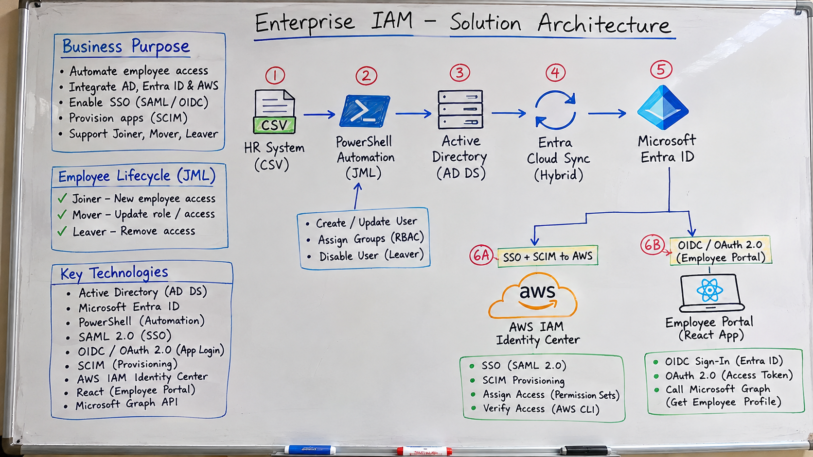
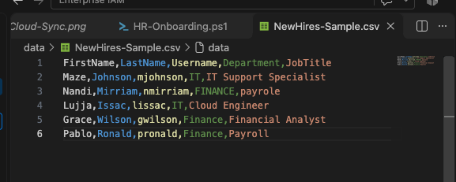
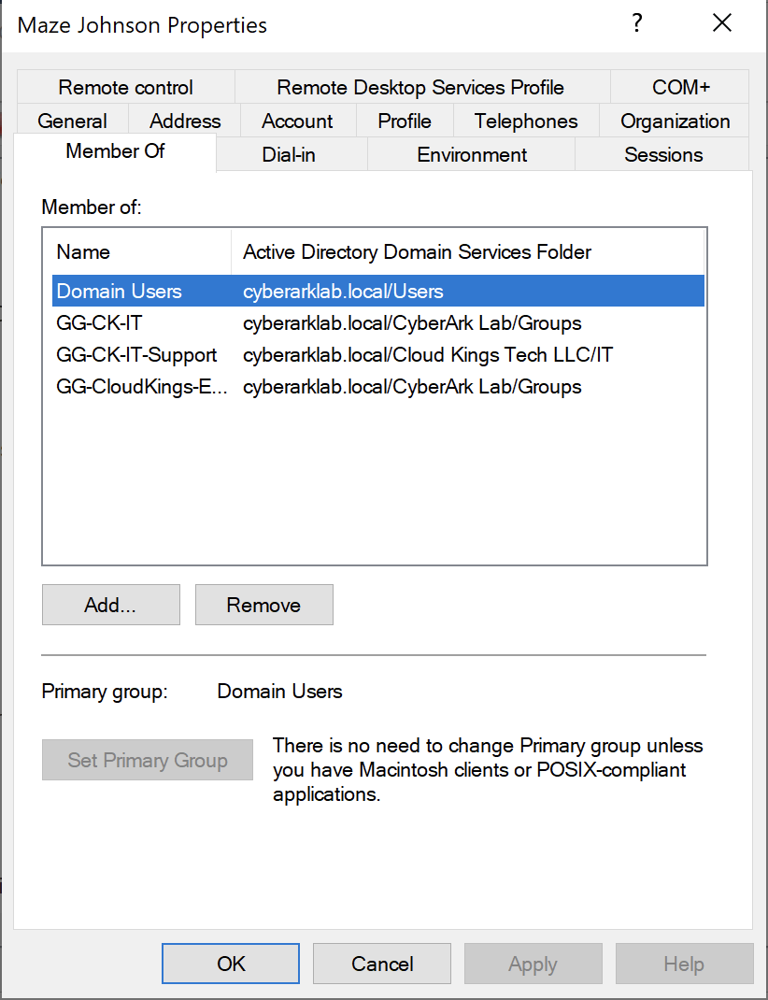
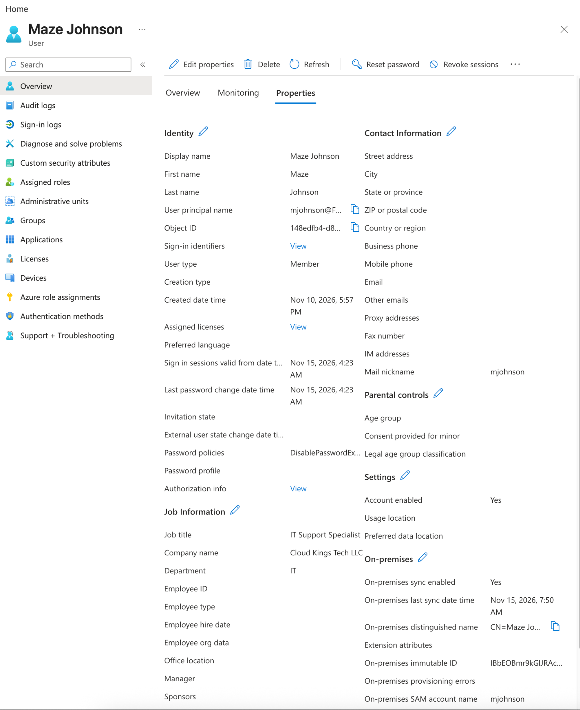
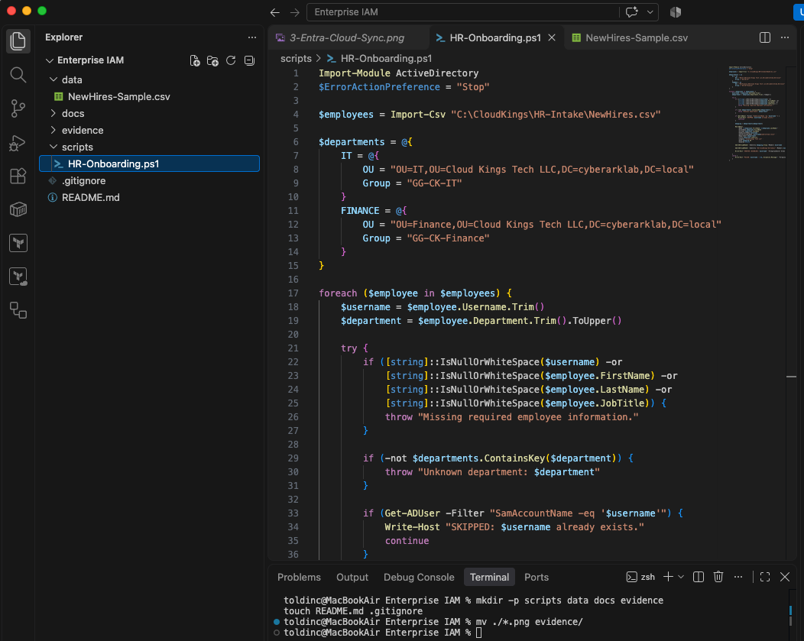
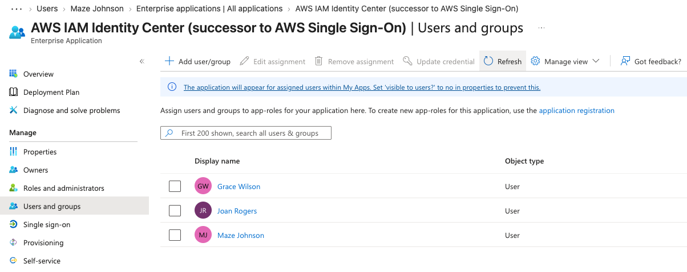
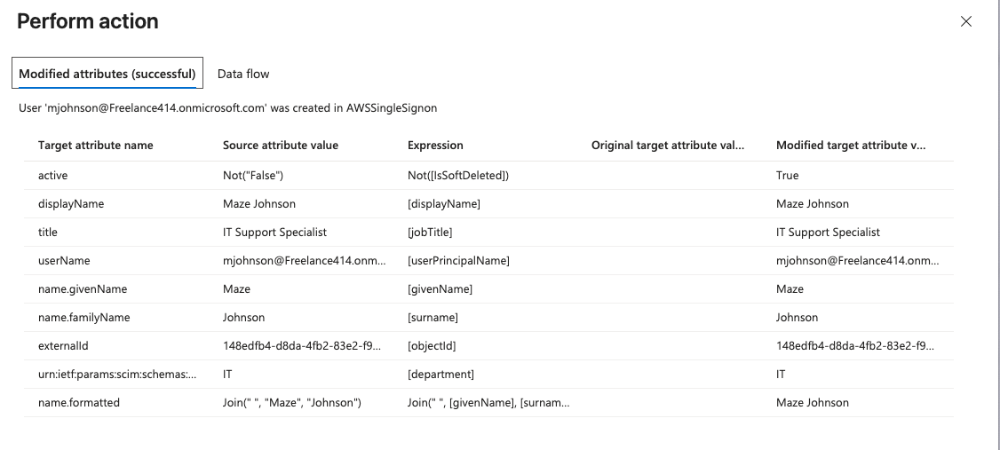
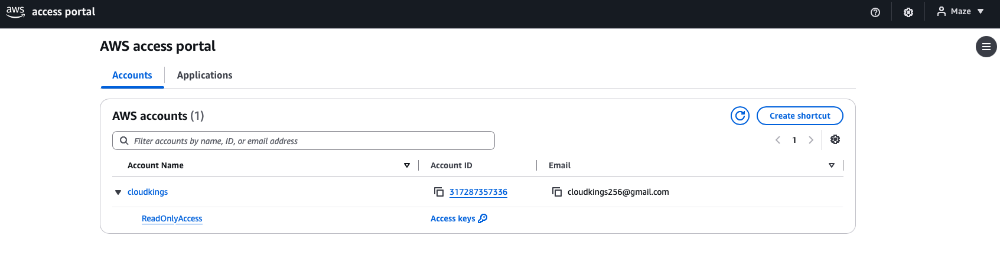
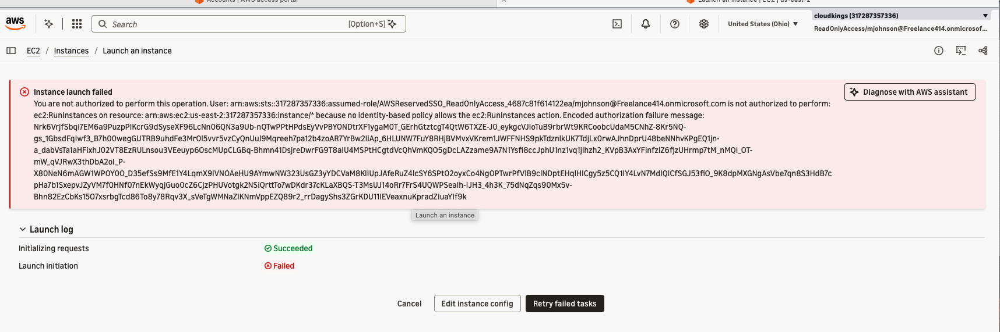
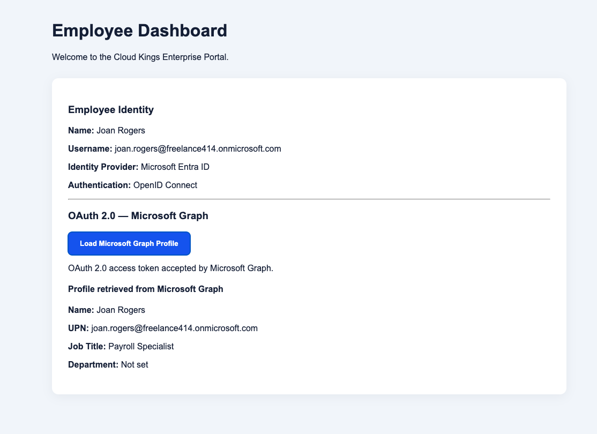

# Cloud Kings Enterprise IAM

## Solution Architecture

## Project Overview

An enterprise identity and access management portfolio project demonstrating employee lifecycle management, hybrid identity, authentication, authorization, privileged access, and identity governance.

## Technologies

- Active Directory Domain Services (AD DS)
- Microsoft Entra ID
- Entra Cloud Sync
- PowerShell
- AWS IAM Identity Center
- SAML 2.0, SCIM, OIDC, OAuth 2.0
- Microsoft Graph API
- Microsoft Entra Privileged Identity Management (PIM)

## Implemented Workflows

### 1. Joiner–Mover–Leaver (JML)

Automated employee onboarding and department changes using PowerShell, Active Directory, and Entra Cloud Sync.

Demonstrated employee termination through account disabling and downstream access revocation.

### 2. Enterprise SSO and Provisioning

Integrated Microsoft Entra ID with AWS IAM Identity Center using SAML SSO and SCIM provisioning.

Demonstrated AWS access assignments and least-privilege testing.

### 3. OIDC and OAuth 2.0

Built a React employee portal integrated with Microsoft Entra ID.

Demonstrated employee authentication and authorized Microsoft Graph profile retrieval.

### 4. Privileged Identity Management (PIM)

Configured Microsoft Entra PIM in a previous Lex1 environment.

Demonstrated eligible User Administrator assignment, MFA and justification requirements, and successful eight-hour privileged role activation.

**Documentation:** [PIM Hands-On](docs/PIM-Privileged-Access.md)

**Evidence:** [PIM Screenshots](evidence/PIM/)

---

### 7. IAM Troubleshooting & Root Cause Analysis

**Incident CK-IAM-TRB-001 — Microsoft Entra Cloud Sync Group Scoping Failure**

During an employee transfer from IT Support to Cloud Engineering, a newly created Active Directory security group failed to appear in Microsoft Entra ID.

- **Business impact:** Delayed role-based access provisioning for transferred employees.
- **Root cause:** Microsoft Entra Cloud Sync was scoped to selected security groups, excluding the new Engineering group.
- **Resolution:** Updated the synchronization scope to include the approved Cloud Kings organizational unit.
- **Verification:** Confirmed the Engineering group synchronized successfully into Entra ID.
- **Skills demonstrated:** Hybrid identity troubleshooting, PowerShell, Active Directory, Entra Cloud Sync, RBAC, and root cause analysis.

**[View the complete troubleshooting case study →](docs/Cloud-Sync-Troubleshooting.md)**

---

## Project Evidence

**[View the Complete IAM Implementation & Evidence Walkthrough](docs/Evidence-Walkthrough.md)**

The following screenshots demonstrate the Cloud Kings IAM workflows.

### 1. HR-Driven Employee Onboarding

### 2. AWS SSO and SCIM Provisioning

### 3. OIDC and OAuth 2.0

For additional evidence, see the [evidence directory](evidence/).

## Security Principles

- Least Privilege
- Role-Based Access Control
- Just-in-Time Privileged Access
- Identity Lifecycle Management
- Separation of Duties
- Auditing and Accountability

### 5. Conditional Access & Identity Protection

Practiced Microsoft Entra Conditional Access security configurations in the earlier Lex1 environment.

- MFA enforcement for Finance employees
- Compliant-device access requirements
- Trusted network and named-location conditions
- Report-only policy configuration
- Sign-in risk and user risk policy settings

These exercises demonstrate Conditional Access configuration and risk-based security controls. Production enforcement was not independently verified.

**Documentation:** [Conditional Access Hands-On](docs/Conditional-Access.md)

**Evidence:** [Conditional Access Screenshots](evidence/Conditional-Access/)

### 6. Dynamic Groups & Role-Based Access Control

Practiced Microsoft Entra ID dynamic group membership
and enterprise application assignment in the Lex1 tenant.

- Created Iverson Kyle with Finance department attributes
- Configured a department-based dynamic membership rule
- Validated membership against three employees
- Assigned the Finance group to an enterprise application

**Documentation:** [Dynamic Groups & RBAC](docs/Dynamic-Group-RBAC.md)

**Evidence:** [Dynamic Groups Screenshots](evidence/Dynamic-Groups/)
