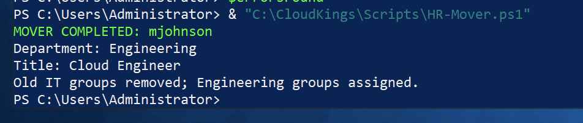
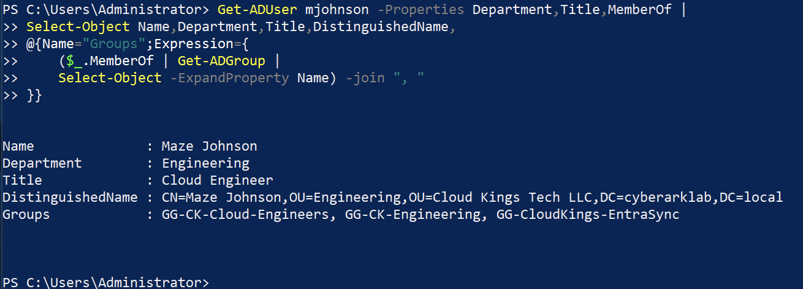
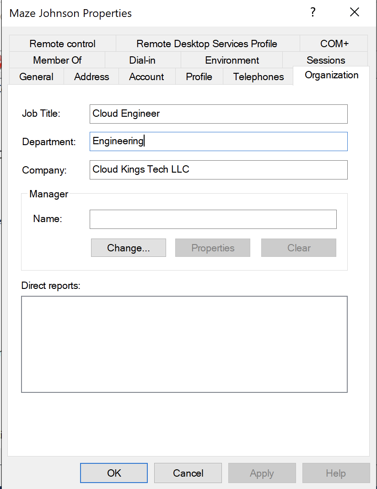
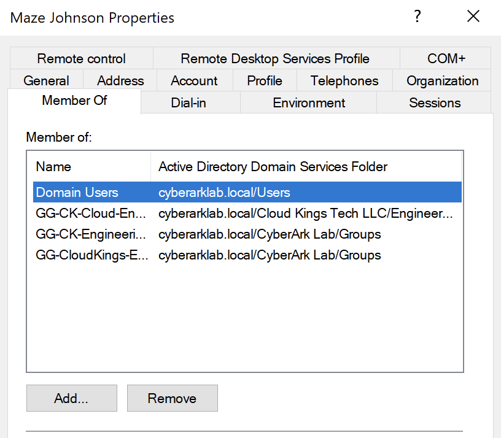
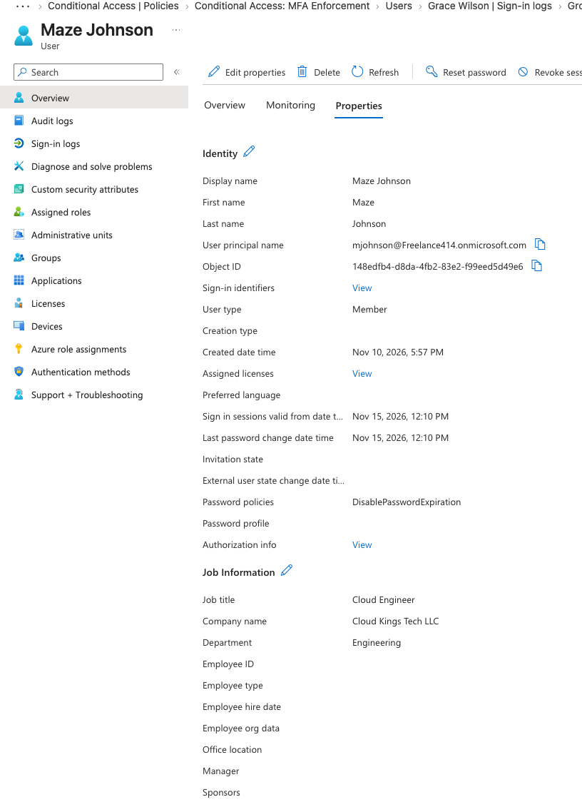

# CK-IAM-TRB-001 — Microsoft Entra Cloud Sync Troubleshooting

## 1. Incident Overview

**Project:** Cloud Kings Enterprise IAM  
**Category:** Hybrid Identity / Provisioning / RBAC  
**Employee:** Maze Johnson (`mjohnson`)  
**Environment:** Active Directory DS → Microsoft Entra Cloud Sync → Entra ID  
**Incident:** Engineering security group missing from Microsoft Entra ID after an employee department transfer  
**Status:** Resolved in the hands-on environment

## 2. Business Problem

Cloud Kings transfers Maze Johnson from IT Support to Cloud Engineering.

The employee must lose outdated IT Support group memberships and receive the appropriate Engineering access.

Although the Active Directory mover workflow completed, the new `GG-CK-Cloud-Engineers` security group was not appearing in Microsoft Entra ID.

This could delay downstream application provisioning and prevent employees from receiving access required for their new responsibilities.

**Business value of resolving this issue:**

- Reduce employee access delays after transfers.
- Maintain accurate hybrid identities.
- Support department-based RBAC.
- Reduce manual IAM troubleshooting.
- Prevent outdated permissions from accumulating.

## 3. Architecture

```text
HR-approved transfer
       |
       v
HR-Mover.ps1
       |
       v
Active Directory (DC01)
       |
       +-- Update department and job title
       +-- Move user to Engineering OU
       +-- Remove previous IT groups
       +-- Add Engineering groups
       |
       v
Microsoft Entra Cloud Sync
       |
       v
Microsoft Entra ID
       |
       v
Downstream application access
```

**Important:** Cloud Sync synchronizes eligible directory objects and attributes. It does not, by itself, guarantee that downstream application permissions have been assigned.

## 4. Symptoms

During the Maze Johnson mover exercise:

1. The mover script completed.
2. Maze's AD department and organizational unit were updated.
3. Engineering group membership was configured in AD.
4. The `GG-CK-Cloud-Engineers` group was initially missing from Entra ID.
5. The hybrid identity workflow therefore required further investigation.

The issue was not resolved by repeatedly running the mover script.

## 5. Investigation — Active Directory

### Step 1: Verify the employee

On DC01, use Active Directory PowerShell:

```powershell
Get-ADUser -Identity "mjohnson" `
    -Properties Department,Title,DistinguishedName |
    Select-Object Name,Department,Title,DistinguishedName
```

**Expected result:**

- Department: Engineering
- Title: Cloud Engineer
- Distinguished name under the Engineering OU

### Step 2: Verify group membership

```powershell
Get-ADPrincipalGroupMembership -Identity "mjohnson" |
    Select-Object Name
```

**Expected result:** The Engineering access groups are present and obsolete IT Support access groups are removed.

### Step 3: Verify the Engineering security group

```powershell
Get-ADGroup -Identity "GG-CK-Cloud-Engineers" `
    -Properties GroupScope,GroupCategory,DistinguishedName |
    Select-Object Name,GroupScope,GroupCategory,DistinguishedName
```

**Purpose:** Confirm the group exists and identify its location in Active Directory.

These are reproducible diagnostic commands. The original screenshots document the AD verification stage; this guide does not claim every command above was captured during the original incident.

## 6. Root Cause

The Entra Cloud Sync configuration was scoped using selected security groups.

The newly created `GG-CK-Cloud-Engineers` group was not included in the synchronization scope.

As a result, the group was available in Active Directory but was not synchronized into Entra ID.

**Root cause category:** Identity synchronization scoping misconfiguration.

The problem was not caused by incorrect department attributes or a failed AD group creation.

## 7. Resolution

The Cloud Sync scoping configuration was updated in Microsoft Entra.

**Administrative workflow:**

1. Open the Microsoft Entra admin center.
2. Navigate to the existing Microsoft Entra Cloud Sync configuration.
3. Review the synchronization scope.
4. Change the scope from selected security groups to selected organizational units.
5. Include:

```text
OU=Cloud Kings Tech LLC,DC=cyberarklab,DC=local
```

6. Save the configuration.
7. Allow synchronization processing to complete.
8. Check Microsoft Entra ID for the Engineering security group.

**Result:** `GG-CK-Cloud-Engineers` appeared in Entra ID, together with other role-based groups included by the selected OU scope.

**Security consideration:** Expanding synchronization scope can introduce additional directory objects into Entra. In production, review the proposed OU scope, exclusions, change approval, and downstream impact before saving.

## 8. Verification

### Active Directory verification

Confirmed that Maze's department, title, OU, and Engineering group memberships reflected the approved transfer.

### Microsoft Entra verification

Confirmed that the previously missing Engineering security group appeared after the Cloud Sync scope was corrected.

### AWS access verification

In the broader mover workflow, Maze received a direct AWS IAM Identity Center assignment for the `CloudEngineerAccess` permission set.

AWS CloudShell verification included:

```bash
aws ec2 describe-vpcs
```

This succeeded.

A restricted IAM operation was also tested:

```bash
aws iam create-user --user-name CK-Mover-Denied-Test
```

This returned `AccessDenied`, demonstrating that the assigned permissions did not allow IAM user creation.

**Important distinction:** AWS access was assigned directly to Maze. The exercise did not establish automated AWS permission assignment through the synchronized Engineering group.

## 9. Original PowerShell Automation

The existing implementation is stored at:

[HR-Mover.ps1](../scripts/HR-Mover.ps1)

The script:

1. Loads the Active Directory module.
2. Locates Maze Johnson.
3. Validates the destination OU and required groups.
4. Updates department and job title.
5. Moves the AD account to the Engineering OU.
6. Removes obsolete IT Support groups.
7. Adds Engineering security groups.
8. Reports completion or failure.

**Relevant commands from the actual script:**

```powershell
Set-ADUser -Identity $username `
    -Department $newDepartment `
    -Title $newTitle

Move-ADObject `
    -Identity $user.DistinguishedName `
    -TargetPath $engineeringOU

foreach ($group in $oldGroups) {
    Remove-ADGroupMember -Identity $group `
        -Members $username -Confirm:$false
}

foreach ($group in $newGroups) {
    Add-ADGroupMember -Identity $group `
        -Members $username
}
```

The script modifies Active Directory. It does not configure Entra Cloud Sync scoping or directly assign AWS IAM Identity Center permission sets.

**Engineering improvement:** The current script is not transactional. If a later group operation fails, earlier changes may already have succeeded. A production implementation should add structured logging, change tracking, and safe recovery or retry handling.

## 10. Evidence Gallery

### Mover automation completed



### Active Directory verification



### Employee organization attributes



### Engineering group membership



### Microsoft Entra synchronization



These screenshots support the mover and successful synchronization outcome. The original Cloud Sync scoping error and configuration change are documented from the hands-on investigation; a dedicated before-and-after scoping screenshot is not included in this gallery.

## 11. Root Cause Analysis

| Question | Finding |
|---|---|
| What failed? | Engineering group synchronization into Entra |
| Was the employee updated in AD? | Yes |
| Was the new group present in AD? | Yes |
| Why was it missing from Entra? | Cloud Sync scoping excluded it |
| What fixed the issue? | Updated selected-OU synchronization scope |
| How was the fix verified? | Group appeared in Entra |
| What was the business impact? | Potential delay in department-based access provisioning |

## 12. Prevention and Operational Monitoring

Recommended improvements:

- Review Cloud Sync scope when introducing new departments, OUs, or role groups.
- Include synchronization requirements in the IAM change process.
- Monitor provisioning errors and synchronization health.
- Validate newly created role groups in both AD and Entra.
- Document approved scoping changes.
- Use controlled testing before expanding synchronization scope.

These are recommended operational controls, not all implemented in this exercise.

## 13. IAM Engineer Interview Story

**Question:** Tell me about an identity synchronization problem you troubleshot.

**Answer:**

"In my Cloud Kings Enterprise IAM project, I simulated an employee department transfer from IT Support to Cloud Engineering.

I automated the Active Directory changes using PowerShell, including updating the employee's department, moving the account into the Engineering OU, removing obsolete groups, and adding new role-based security groups.

During verification, I noticed that the new Cloud Engineers group was missing from Microsoft Entra ID.

I investigated the Active Directory configuration and found that the group existed locally, which narrowed the problem to the synchronization layer.

The root cause was the Microsoft Entra Cloud Sync scoping configuration, which was limited to selected security groups.

I updated the synchronization scope to include the Cloud Kings organizational unit and verified that the Engineering group appeared in Entra.

This exercise demonstrated hybrid identity troubleshooting, directory scoping, PowerShell automation, RBAC, and end-to-end verification."

## 14. Lessons Learned

- Successful AD automation does not guarantee successful cloud synchronization.
- Verify identity changes at every system boundary.
- Distinguish synchronization failures from authorization failures.
- Avoid unnecessary script reruns when the problem is outside the script.
- Review the security impact before changing synchronization scope.
- Capture evidence of both the technical fix and the business outcome.

## 15. Completion Status

- Employee mover automation: Verified
- AD attributes and group membership: Verified
- Cloud Sync scoping root cause: Identified
- Cloud Sync scope correction: Completed
- Entra group synchronization: Verified
- AWS access validation: Verified separately through direct assignment
- Root cause analysis: Documented
- Prevention recommendations: Documented
