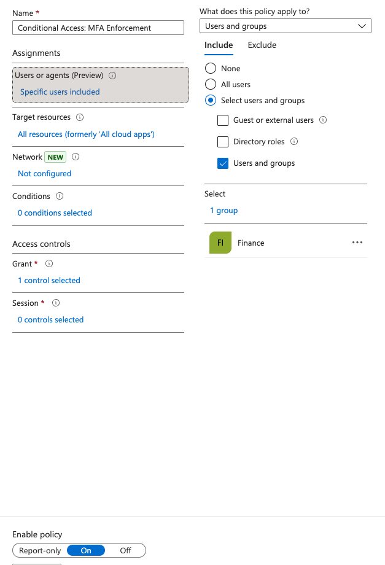
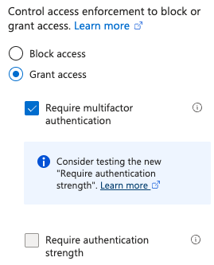
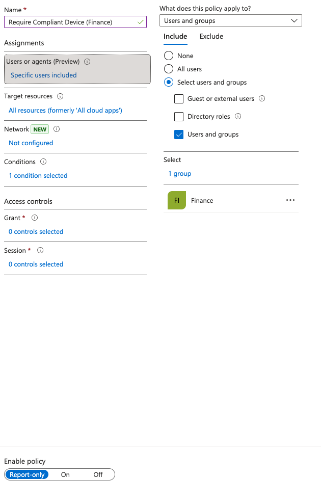
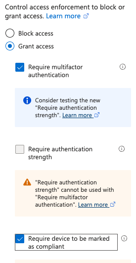
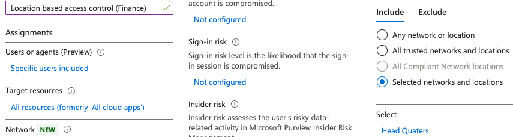
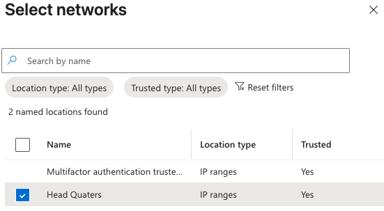

# Cloud Kings Enterprise IAM
## Microsoft Entra Conditional Access & Identity Protection

### 1. Project Overview

**Technology:** Microsoft Entra Conditional Access and Identity Protection  
**Environment:** Lex1 (previous hands-on environment)  
**Business scenario:** Securing employee access to enterprise applications

**Objective:** Demonstrate how IAM engineers configure identity security policies using MFA, device compliance, trusted locations, and identity risk signals.

### 2. Business Scenario

Cloud Kings employees access enterprise applications using Microsoft Entra ID.

The organization requires security controls to reduce unauthorized access, protect sensitive information, and enforce least privilege.

The Finance department is used as the example policy target.

### 3. Conditional Access — MFA Enforcement

**Policy:** Conditional Access: MFA Enforcement

Configuration shown:
- Target group: Finance
- Target resources: All cloud apps
- Grant access: Require multifactor authentication

#### 1. MFA Enforcement Policy

#### 2. MFA Grant Control

#### 3. Compliant Device Policy

#### 4. Device Compliance Grant Control

#### 5. Location-Based Access Policy

#### 6. Trusted Named Location

### 4. Conditional Access — Compliant Device

**Policy:** Require Compliant Device (Finance)

Configuration shown:
- Target group: Finance
- Target resources: All cloud apps
- Grant controls: Require MFA and require device to be marked compliant
- Policy setting selected: Report-only

**Purpose:** Restrict access to devices that meet organizational security requirements.

Report-only mode allows administrators to evaluate expected policy decisions without enforcing the grant requirements.

The screenshots do not show the grant-control combination setting or a completed report-only evaluation.

**Evidence:**
- `03-device-policy-overview.png`
- `04-device-grant-control.png`

### 5. Conditional Access — Location-Based Access

**Policy:** Location based access control (Finance)

Configuration shown:
- Selected network/location: Head Quaters
- Location represented by an IP range
- Named location marked as trusted

**Purpose:** Allow IAM administrators to include or exclude specific network locations when defining access conditions.

Selecting a trusted location does not automatically grant access or block access. The policy's full conditions and grant controls determine the outcome.

**Evidence:**
- `05-location-policy-overview.png`
- `06-named-location.png`

### 6. Identity Protection — Risk-Based Access

Additional configuration exercises demonstrated:

**Sign-in risk**
- Evaluating whether an individual authentication attempt is suspicious
- Selecting risk thresholds, including High
- Exploring block-access controls

**User risk**
- Evaluating whether an employee identity may be compromised
- Selecting risk thresholds, including High
- Exploring risk-based access restrictions

These exercises demonstrate configuration knowledge. The available screenshots do not establish final policy enforcement or a completed risk-remediation incident.

**Design consideration:** Use separate policies for user risk and sign-in risk rather than combining both conditions in one policy.

### 7. End-to-End IAM Workflow

Example employee: Joan Rogers

1. Joan opens the Cloud Kings Employee Portal.
2. Microsoft Entra ID authenticates Joan using OpenID Connect.
3. Applicable Conditional Access policies are evaluated.
4. Entra evaluates relevant conditions, such as group membership, risk, and device state.
5. Joan must satisfy the applicable grant requirements.
6. If access is permitted, authentication completes and the portal can obtain tokens for its authorized operations.
7. IAM engineers can investigate sign-in logs and Conditional Access results if authentication fails.

**Important:** This is the intended enterprise workflow. The earlier Lex1 policy screenshots do not prove those policies were applied to Joan in the current portal environment.

### 8. IAM Troubleshooting Scenario

**Ticket:** INC-1050 — Finance employee cannot access enterprise application

**Reported issue:** An employee reports being unable to sign in.

**Investigation:**
1. Locate the employee's sign-in event in Entra sign-in logs.
2. Inspect the authentication result and Conditional Access tab.
3. Identify which policy applied and whether access was blocked.
4. Check MFA, device compliance, group assignment, and location conditions.
5. Apply an approved correction if a misconfiguration is confirmed.
6. Retest and document the outcome.

**Expected result:** The employee can access authorized applications while security requirements remain enforced.

This is a proposed troubleshooting exercise, not a previously completed incident.

### 9. Evidence

Store the six Conditional Access screenshots under:

`evidence/Conditional-Access/`

1. `01-mfa-policy-overview.png`
2. `02-mfa-grant-control.png`
3. `03-device-policy-overview.png`
4. `04-device-grant-control.png`
5. `05-location-policy-overview.png`
6. `06-named-location.png`

Identity Protection screenshots can be added separately under:

`evidence/Identity-Protection/`

### 10. Interview Explanation

"In my Microsoft Entra hands-on environment, I configured Conditional Access policy settings for MFA enforcement, device compliance, and named locations.

I scoped policies to a Finance security group, selected MFA and compliant-device grant controls, and explored report-only evaluation.

I also practiced configuring Identity Protection risk conditions for suspicious sign-ins and potentially compromised users.

These exercises helped me understand how IAM engineers design risk-based access policies and troubleshoot authentication failures using Entra sign-in logs."

### 11. Project Status

| Capability | Status |
|---|---|
| MFA Conditional Access configuration | Demonstrated |
| Finance group policy scoping | Demonstrated |
| Compliant-device policy configuration | Demonstrated |
| Report-only setting | Demonstrated |
| Trusted named-location selection | Demonstrated |
| Identity Protection risk conditions | Practiced |
| Saved policy enforcement | Not independently verified |
| Sign-in log troubleshooting | Planned |

### 12. Security Principles

- Zero Trust
- Least Privilege
- Strong Authentication
- Risk-Based Access Control
- Device Compliance
- Identity Protection
- Auditing and Accountability
