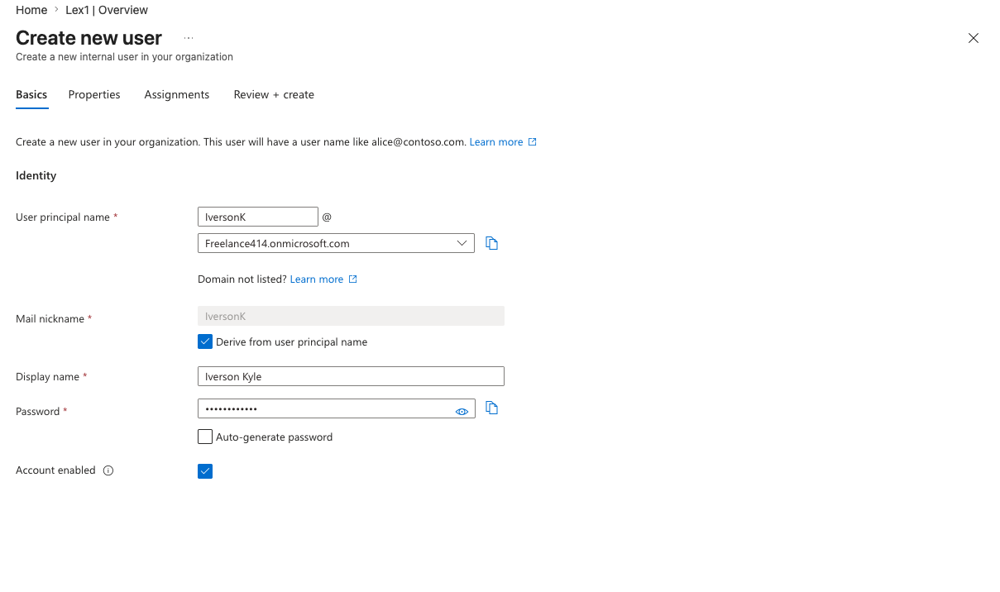
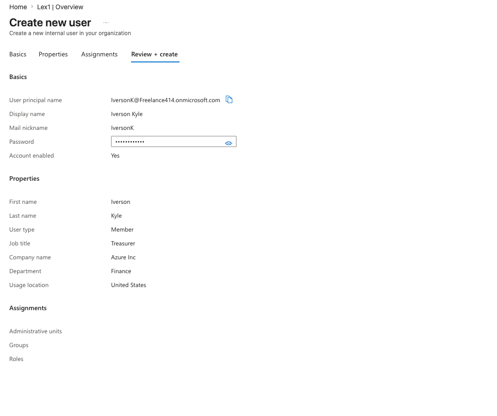
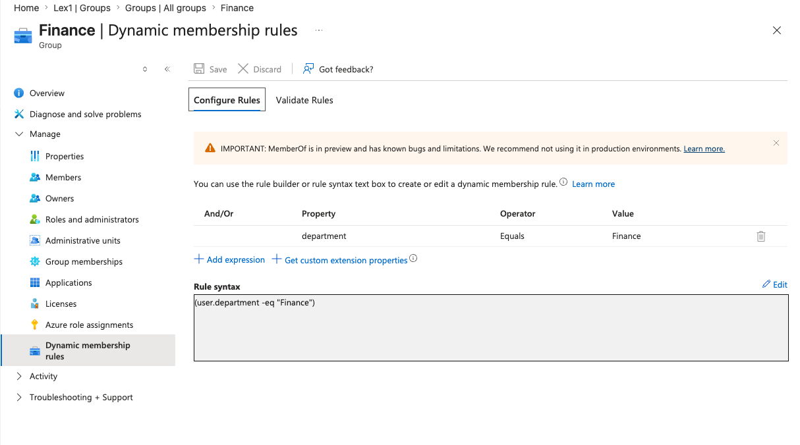
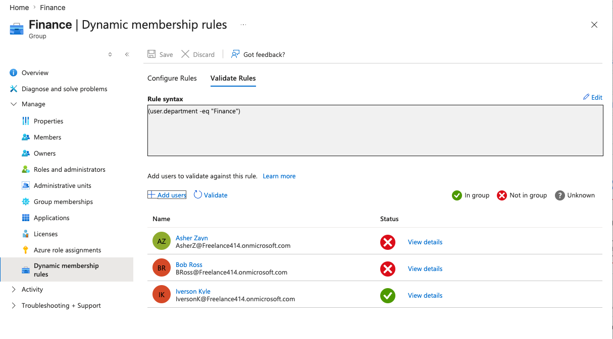
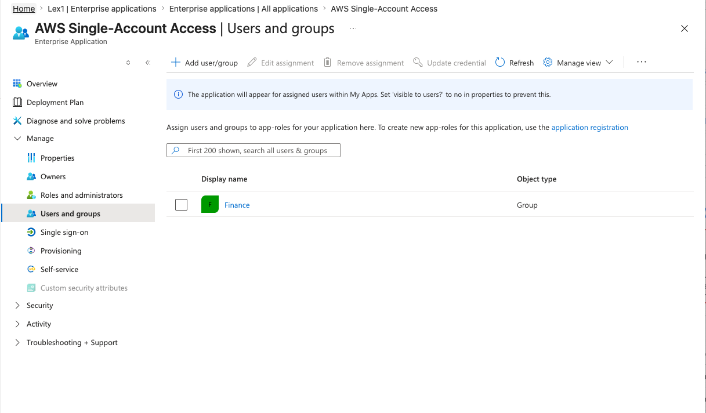

# Cloud Kings Enterprise IAM
## Dynamic Group Membership & Role-Based Access Control

### 1. Project Overview

**Technology:** Microsoft Entra ID  
**Environment:** Lex1 (previous hands-on environment)  
**Business scenario:** Automated department-based access management

**Objective:** Demonstrate how employee attributes can drive dynamic security group membership and support application access management.

### 2. Business Scenario

Cloud Kings wants to reduce manual group membership administration.

When an employee joins the Finance department, Microsoft Entra ID should evaluate the employee's department attribute and automatically include them in the appropriate dynamic security group.

This allows IAM engineers to manage access through identity attributes and group-based application assignments.

### 3. Employee Identity Creation

**Employee:** Iverson Kyle  
**Username:** IversonK@Freelance414.onmicrosoft.com  
**Department:** Finance  
**Job title:** Treasurer

The screenshots demonstrate configuring a new employee identity in Microsoft Entra ID, including employee attributes.

The screenshots show the creation workflow but do not independently confirm successful account creation.

### 4. Dynamic Security Group Configuration

**Group:** Finance

Dynamic membership rule:

```powershell
(user.department -eq "Finance")
```

**How it works:**

1. Microsoft Entra evaluates the employee's department attribute.
2. If the department equals Finance, the user matches the group rule.
3. If the department does not equal Finance, the user does not match.
4. When employee attributes change, Entra reevaluates dynamic membership.

Dynamic membership processing is asynchronous and may not update immediately.

### 5. Dynamic Membership Validation

The Validate Rules screenshot shows:

| Employee | Validation result |
|---|---|
| Iverson Kyle | In group |
| Bob Ross | Not in group |
| Asher Zayn | Not in group |

**Result:** The rule correctly evaluated Iverson Kyle as matching the Finance membership condition.

This demonstrates successful rule validation, not independent confirmation that all membership changes finished processing.

### 6. Enterprise Application Assignment

**Application:** AWS Single-Account Access  
**Assigned group:** Finance

The screenshot shows the Finance group listed under the enterprise application's Users and groups assignments.

**Purpose:** Manage application assignment through group membership rather than individually assigning every employee.

**Important:** This screenshot does not independently verify successful AWS sign-in, SCIM provisioning, or AWS account permissions.

### 7. Connection to the Cloud Kings JML Workflow

**Joiner:**
- HR creates an employee with Department = Finance.
- Entra evaluates the employee against the Finance dynamic group rule.
- The employee becomes eligible for group-based application assignments after membership processing.

**Mover:**
- HR changes the employee's department from Finance to Cloud Engineering.
- Entra reevaluates dynamic membership.
- The employee no longer matches the Finance group rule.
- Any access dependent on that membership can be updated, subject to application provisioning and authorization behavior.

**Leaver:**
- The employee account is disabled through the organization's offboarding workflow.
- IAM engineers verify downstream access revocation, sessions, and application assignments.

This section describes the intended enterprise workflow. The previous Lex1 screenshots demonstrate configuration and rule validation, not a complete JML execution for Iverson.

### 8. IAM Troubleshooting Scenario

**Ticket:** INC-1060 — Employee missing Finance application access

**Reported issue:** A newly hired Finance employee cannot access an assigned enterprise application.

**Investigation:**

1. Verify the employee's department attribute.
2. Inspect the dynamic membership rule.
3. Validate the employee against the rule.
4. Check group membership processing status.
5. Confirm the group is assigned to the enterprise application.
6. Review provisioning and sign-in logs where applicable.
7. Retest access after resolving the issue.

**Expected result:** The employee receives the appropriate access without unnecessary manual permissions.

This is a proposed troubleshooting scenario, not a previously completed incident.

### 9. Evidence

Store screenshots under:

`evidence/Dynamic-Groups/`

#### 1. Employee Creation



#### 2. Employee Attributes



#### 3. Dynamic Membership Rule



#### 4. Membership Rule Validation



#### 5. Enterprise Application Assignment



### 10. Interview Explanation

"In my Microsoft Entra hands-on environment, I configured a dynamic Finance security group using the employee department attribute.

I used the rule `(user.department -eq "Finance")` and validated it against three identities. The Finance employee matched the rule, while two other users did not.

I also demonstrated group-based enterprise application assignment by assigning the Finance group to an AWS enterprise application.

This helped me understand how identity attributes, dynamic groups, and application assignments work together to reduce manual access administration."

### 11. Project Status

| Capability | Status |
|---|---|
| Employee attribute configuration | Demonstrated |
| Dynamic membership rule configuration | Demonstrated |
| Dynamic rule validation | Verified |
| Enterprise application group assignment | Demonstrated |
| Actual AWS permissions through this group | Not verified |
| Automatic mover access removal | Conceptual |
| IAM troubleshooting scenario | Planned |

### 12. Security Principles

- Attribute-Based Access Control
- Role-Based Access Control
- Least Privilege
- Automated Identity Lifecycle Management
- Group-Based Application Assignment
- Access Governance


## Evidence

### 1. Employee Creation


### 2. Employee Attributes


### 3. Dynamic Group Rule


### 4. Rule Validation


### 5. Enterprise Application Assignment

