# Enterprise IAM — Implementation & Evidence Walkthrough

## Project Overview

This project demonstrates how an organization can manage employee identities and access across Active Directory, Microsoft Entra ID, AWS IAM Identity Center, and a custom employee application.

The implementation follows an employee through onboarding, department transfer, and termination, with supporting authentication, authorization, provisioning, and troubleshooting evidence.

## Business Problem

Organizations operating hybrid identity environments face several challenges:

- Manual onboarding can delay employee productivity.
- Department transfers can leave employees with outdated permissions.
- Disconnected identity systems can cause provisioning failures.
- Delayed offboarding can leave unnecessary access active.
- Security teams need evidence that access controls work.

## Solution

Implement a repeatable IAM workflow using:

1. HR employee data
2. PowerShell lifecycle automation
3. Active Directory Domain Services
4. Microsoft Entra Cloud Sync
5. Microsoft Entra ID
6. SAML SSO and SCIM provisioning
7. AWS IAM Identity Center
8. OIDC and OAuth 2.0 for a React employee portal

The following screenshots document the implementation and verification.

---

# Phase 1 — Employee Onboarding (Joiner)

## Step 1 — Prepare HR Employee Data

The onboarding workflow begins with employee information maintained in a CSV file.

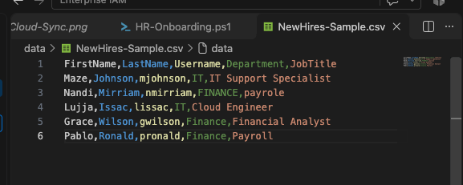

**Purpose:** Provide a structured source of employee attributes for identity creation.

## Step 2 — Create the Employee in Active Directory

Maze Johnson's account was created in the on-premises Active Directory environment.

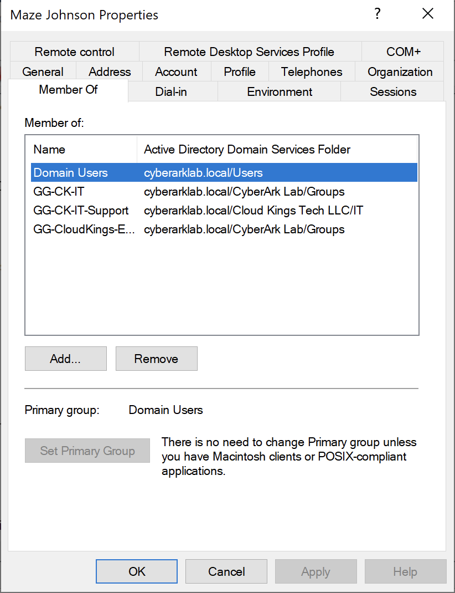

**Purpose:** Establish the employee's corporate identity and group memberships.

## Step 3 — Synchronize Identity to Entra ID

Microsoft Entra Cloud Sync connects the on-premises directory with Microsoft Entra ID.

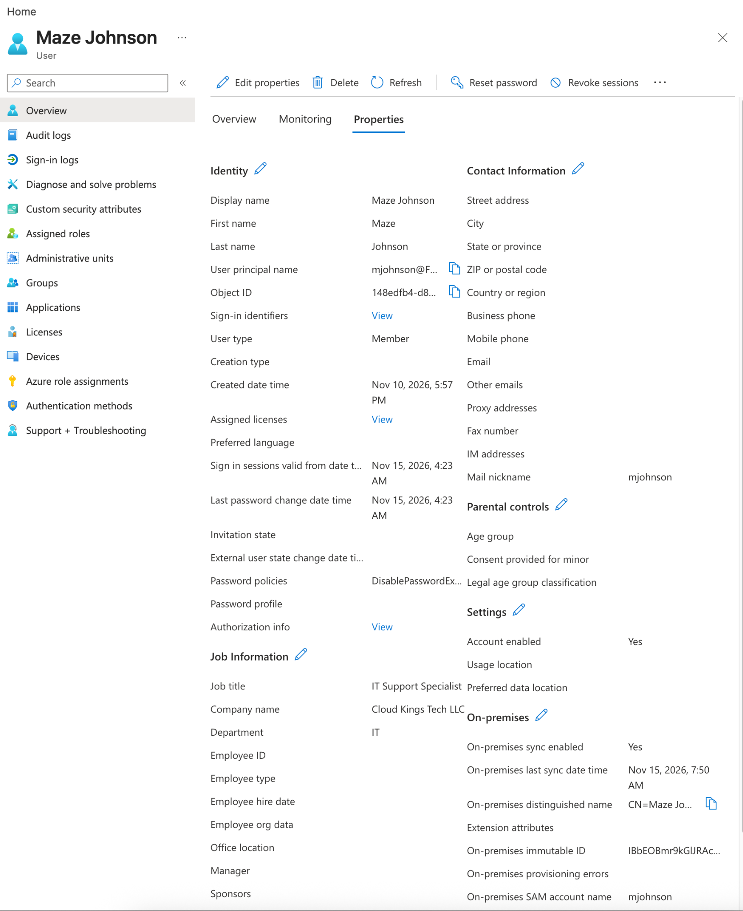

**Purpose:** Make eligible on-premises identities available in the cloud identity platform.

## Step 4 — Execute HR Onboarding Automation

PowerShell automates employee account creation and directory group assignment.

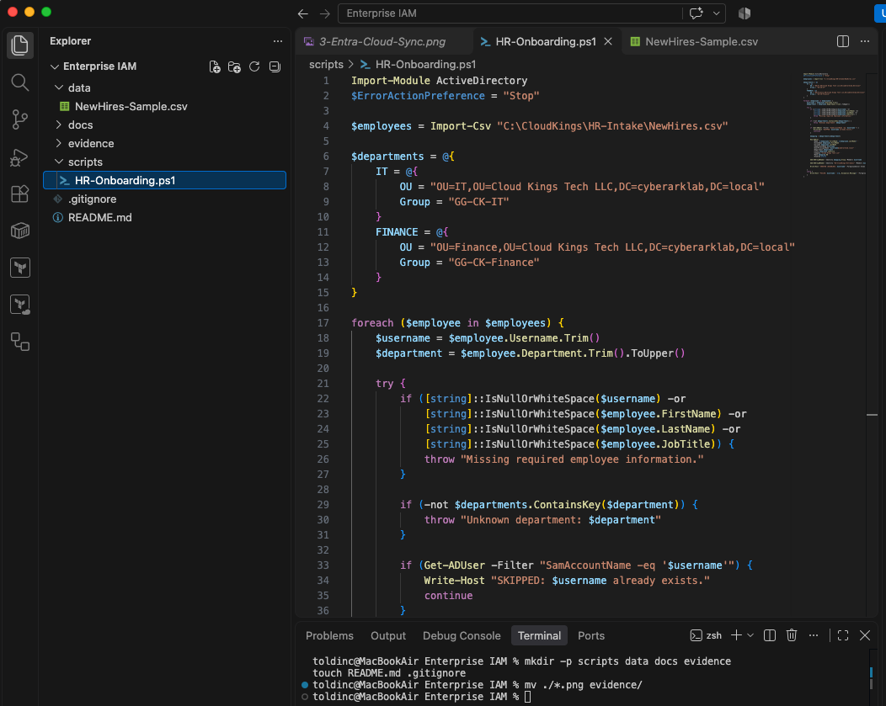

**Script:** [HR-Onboarding.ps1](../scripts/HR-Onboarding.ps1)

**Business value:** Improve consistency and reduce repetitive manual account administration.

## Step 5 — Configure AWS Enterprise Application Access

Microsoft Entra ID is integrated with AWS IAM Identity Center.

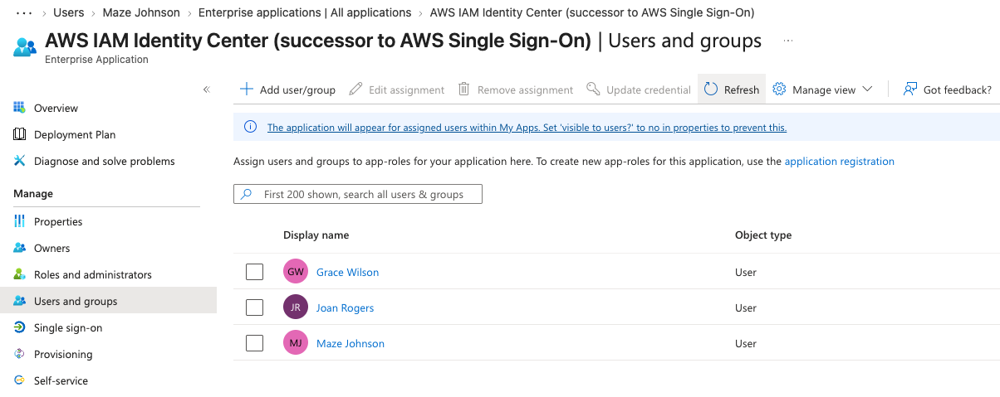

**Purpose:** Establish the enterprise application integration used for workforce identity access.

## Step 6 — Configure SCIM Provisioning

SCIM supports provisioning employee identities from Entra ID into AWS IAM Identity Center.

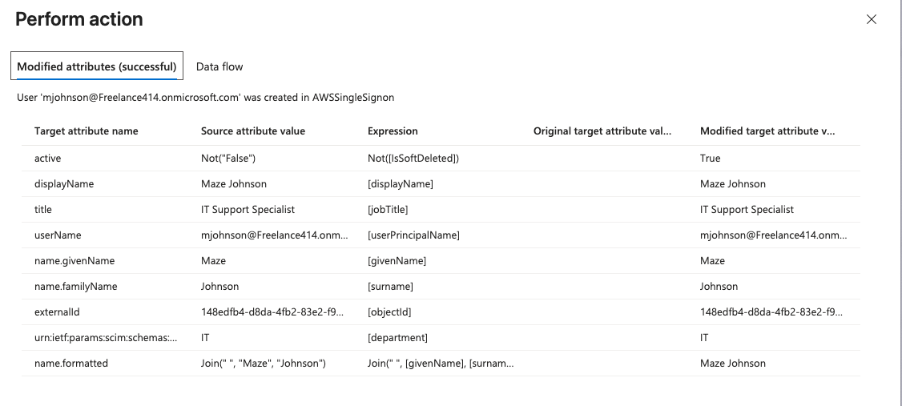

### Additional SCIM Evidence

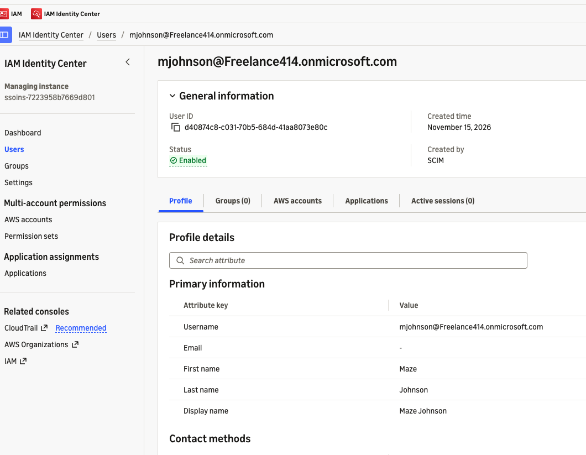

**Purpose:** Reduce the need to maintain separate employee identity records manually.

SCIM user provisioning is distinct from assigning AWS account permissions.

## Step 7 — Verify SAML Single Sign-On

SAML 2.0 enables federated authentication to AWS IAM Identity Center.

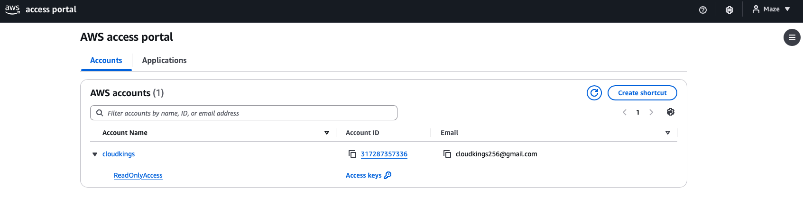

**Purpose:** Provide centralized workforce authentication.

## Step 8 — Test Least-Privilege Access

A restricted AWS operation was denied while the employee had ReadOnlyAccess.

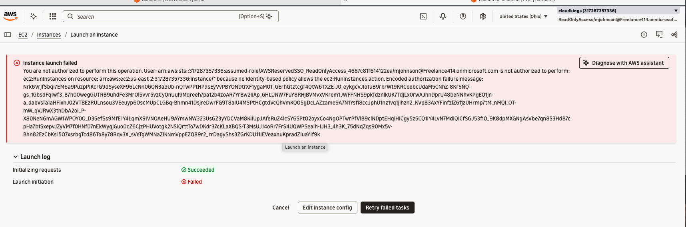

**Security outcome:** Demonstrate that authenticated employees do not automatically receive unrestricted AWS permissions.

## Step 9 — Conditional Access and MFA Evidence

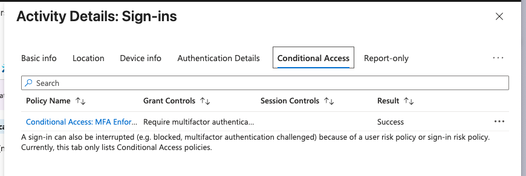

**Purpose:** Illustrate identity security controls associated with cloud authentication.

Additional Conditional Access configurations were practiced in an earlier Entra environment. Configuration evidence should not be interpreted as proof that every policy was enforced during the AWS sign-in.

[Conditional Access documentation](Conditional-Access.md)

---

# Phase 2 — Employee Department Transfer (Mover)

## Business Scenario

Maze Johnson transfers from IT Support to Cloud Engineering.

The IAM team must update the employee's directory attributes, organizational placement, group memberships, and appropriate AWS access.

## Step 10 — Run the Mover Automation

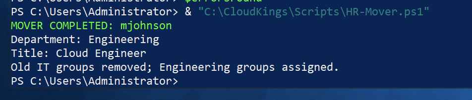

**Script:** [HR-Mover.ps1](../scripts/HR-Mover.ps1)

## Step 11 — Verify Active Directory Changes

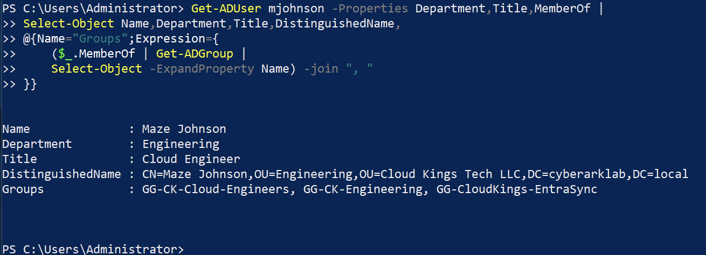

## Step 12 — Verify Department and Job Title

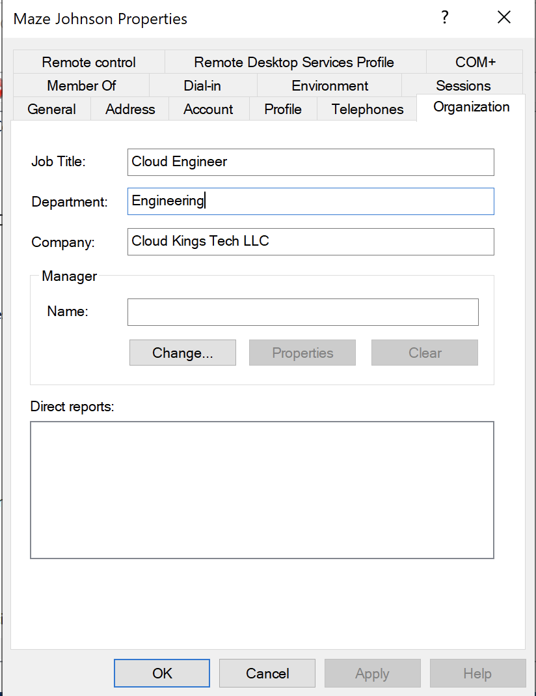

## Step 13 — Verify Engineering Group Membership

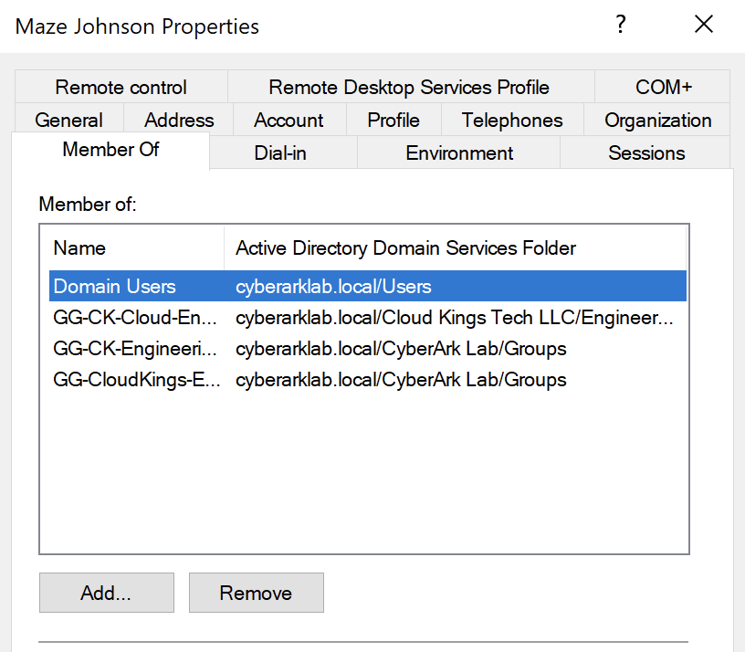

**Security purpose:** Align directory access with the employee's new responsibilities.

## Step 14 — Verify Microsoft Entra Synchronization

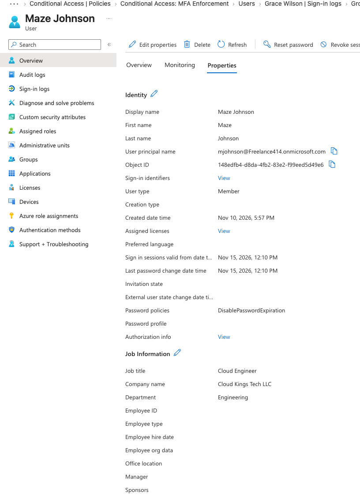

During the mover exercise, the Engineering group initially failed to appear in Entra ID because of Cloud Sync scoping.

The synchronization scope was corrected, and the group subsequently appeared.

**Troubleshooting case study:**

[CK-IAM-TRB-001 — Cloud Sync Group Scoping Failure](Cloud-Sync-Troubleshooting.md)

## Step 15 — Update AWS Access

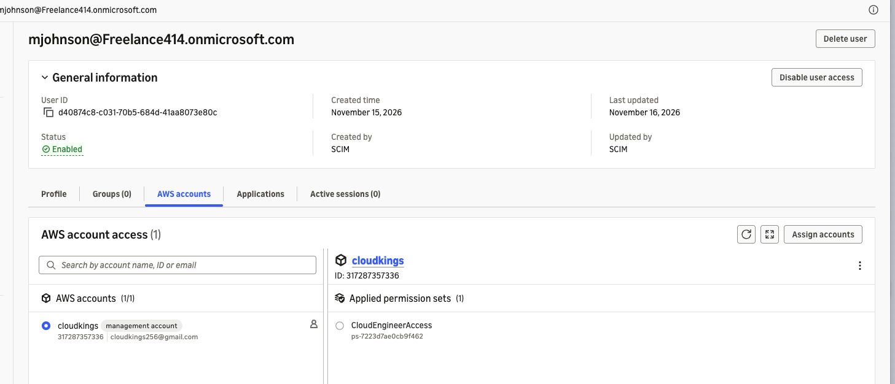

The CloudEngineerAccess permission set was assigned directly in AWS IAM Identity Center.

**Implementation boundary:** Group-based automatic AWS account permission assignment was not demonstrated in this environment.

## Step 16 — Verify AWS SSO

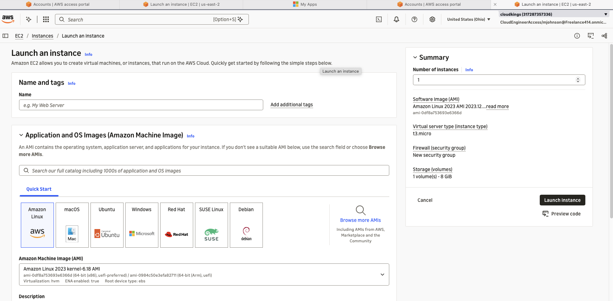

## Step 17 — Verify Authorized AWS Operations

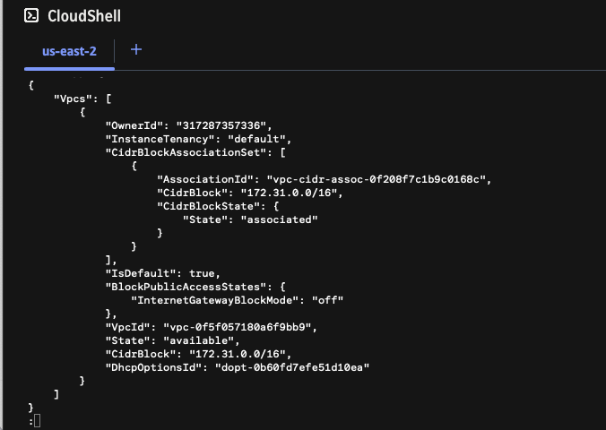

**Validation command:**

```bash
aws ec2 describe-vpcs
```

The command succeeded.

## Step 18 — Verify Restricted IAM Operations

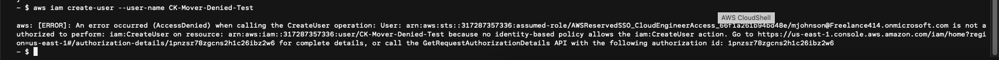

**Validation command:**

```bash
aws iam create-user --user-name CK-Mover-Denied-Test
```

The request returned AccessDenied.

**Security outcome:** Confirm the employee can perform an authorized cloud operation while a restricted IAM operation remains denied.

---

# Phase 3 — Employee Termination (Leaver)

## Business Scenario

Maze Johnson leaves the organization.

The IAM team must disable the corporate identity, verify downstream deprovisioning, and remove remaining AWS access assignments.

## Step 19 — Disable the Employee Identity

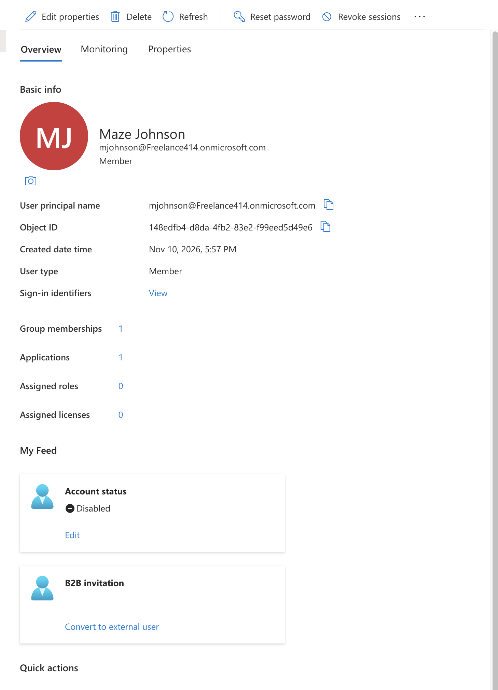

**Script:** [HR-Leaver.ps1](../scripts/HR-Leaver.ps1)

The Active Directory account was disabled and the disabled state was subsequently observed in Entra ID.

## Step 20 — Verify SCIM Deprovisioning

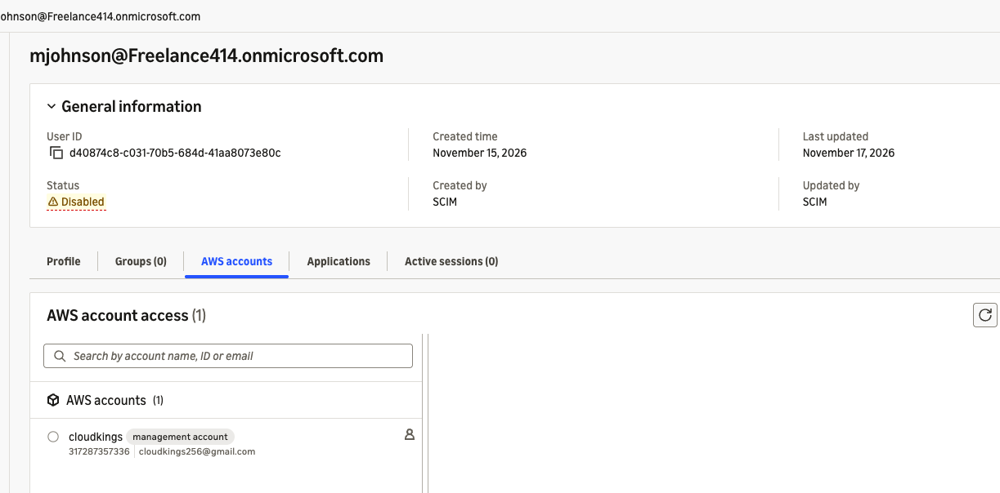

**Purpose:** Verify that the employee's disabled identity state reaches the downstream AWS identity system.

## Step 21 — Remove AWS Account Access

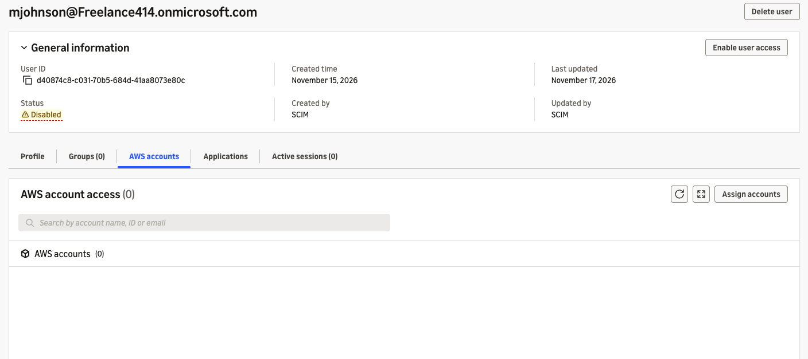

AWS account assignments were removed separately and verified.

**Important:** This assignment removal was not performed automatically by HR-Leaver.ps1.

## Step 22 — Verify Sign-In Is Blocked

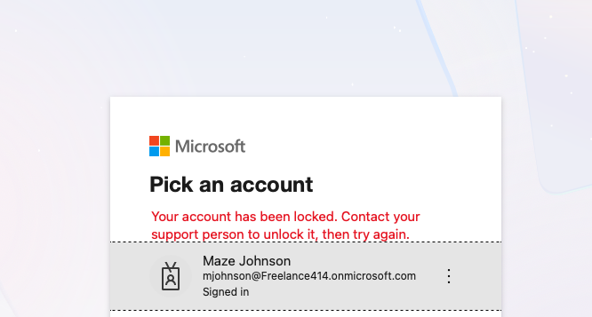

**Security outcome:** Demonstrate denial of new sign-in attempts after employee deactivation.

This does not independently prove immediate revocation of every previously issued session or temporary credential.

---

# Phase 4 — Modern Application Authentication

## Business Scenario

Employees need to sign in to a company application using their corporate identities rather than separate application passwords.

## Step 23 — OIDC Authentication and OAuth 2.0 Authorization

A React employee portal was integrated with Microsoft Entra ID.

Joan Rogers successfully authenticated to the portal, which retrieved her employee profile through Microsoft Graph.

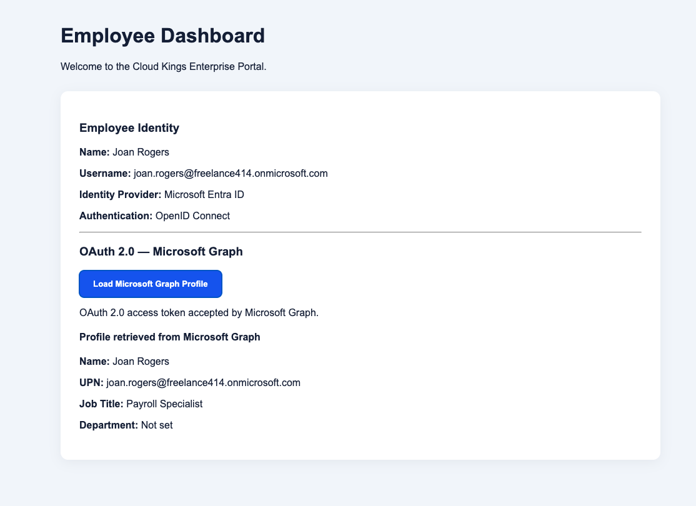

### Protocol Responsibilities

**OpenID Connect (OIDC)**

Provides the identity authentication flow for the employee portal.

**OAuth 2.0**

Provides delegated authorization for Microsoft Graph access.

**Microsoft Graph**

Returns employee profile information to the application.

**Important:** This portal demonstration used Joan Rogers, while the AWS JML lifecycle exercise used Maze Johnson.

---

# Troubleshooting and Engineering Lessons

## Incident CK-IAM-TRB-001

**Problem:** Newly created Engineering security group missing from Microsoft Entra ID.

**Root cause:** Microsoft Entra Cloud Sync scoping excluded the group.

**Resolution:** Updated the synchronization scope to include the appropriate organizational unit.

**Verification:** Engineering group appeared in Entra ID.

[Read the complete root cause analysis](Cloud-Sync-Troubleshooting.md)

## Lessons Learned

1. Successful AD changes do not guarantee successful cloud synchronization.
2. Identity provisioning and access authorization are separate processes.
3. Role changes require verification across multiple systems.
4. Employee termination requires downstream access checks.
5. Authentication success does not imply unrestricted authorization.
6. Technical evidence and troubleshooting documentation are essential to IAM operations.

---

# Project Outcomes

- Demonstrated HR-driven Active Directory identity automation.
- Integrated AD DS with Microsoft Entra ID using Cloud Sync.
- Configured SAML SSO and SCIM provisioning for AWS IAM Identity Center.
- Validated AWS access permissions through positive and negative tests.
- Executed Joiner, Mover, and Leaver exercises.
- Diagnosed and resolved a hybrid identity synchronization issue.
- Demonstrated OIDC authentication and OAuth 2.0 Microsoft Graph access.
- Documented the implementation with screenshots, scripts, and troubleshooting evidence.

**Environment:** Hands-on enterprise IAM portfolio implementation using a fictional company scenario.
